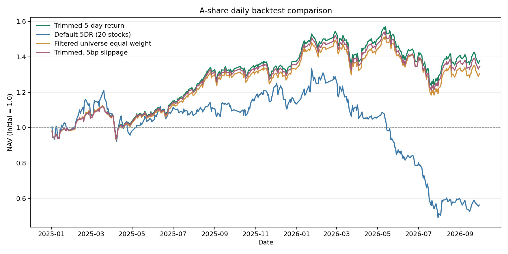

# A 股日频回测作业报告

## 实验口径

- 数据：课程 Feather 全市场矩阵，5,451 只证券；回测区间 2025-01-02 至 2026-09-30。
- 信号锚点：2024-12-31 收盘；次交易日开盘建仓；之后每 5 个交易日收盘更新一次信号。
- 清仓：2026-09-29 收盘发出零仓位目标，2026-09-30 开盘执行；剩余可交易持仓在 9 月 30 日收盘按剩余容量尝试清仓。
- 资金及约束：初始资金 ¥1,000,000,000；普通股票买入 100 股整手，科创板最低 200 股且可逐股递增，北交所最低 100 股且可逐股递增；每只证券每日买卖合计不超过前一交易日成交额的 10%。
- 费用：佣金单边 1 bp、无最低佣金；卖出印花税 5 bp；主结果滑点 0 bp。
- 股票池：上市至少 60 个交易日；按前一交易日成交额剔除候选池中流动性最低 20%；信号日有有效行情和成交。
- ST 推断：课程矩阵没有 ST 标记。主板在 2026-07-06 前使用过去 60 个交易日内两次 ±5% 一字板的价格行为推断，已识别者持续剔除；规则变化后新出现的主板 ST、无适用代理规则的板块记为状态未知。未知证券仍进入当前宽松股票池。

## 策略

主策略每 5 个交易日计算复权 5 日收益，剔除收益最高和最低的各 10%，其余证券等权持有。运行时参数固定为：5 日窗口、两端各 10%、60 日上市期、成交额最低 20% 过滤、10% 单股成交容量。此包没有声称做过训练期网格搜索；参数按提交规格固定，结果为 2025–2026 评估区间的实跑结果。

对照组使用相同区间、股票池、调仓节奏、资金、费率、容量及涨跌停/T+1 规则：系统默认 5DR 反转策略（20 只）和合格股票等权基准。另运行主策略 5 bp 滑点敏感性。

这里的默认 5DR 对照按系统策略模板定义为筛选值最低的 20 只股票；不同代码对 5DR 的方向、持仓数或执行口径定义不同，结果不能直接横向照搬。

## 实跑结果

| 策略 | 总收益 | 年化收益 | 最大回撤 | 夏普 | 期末净值 | 期末持仓市值 |
|---|---:|---:|---:|---:|---:|---:|
| 主策略（剔除两端极值） | 37.73% | 20.18% | -21.20% | 1.02 | ¥1,377,289,186 | ¥4,136,990 |
| 系统默认 5DR（20 只） | -43.64% | -28.06% | -63.10% | -0.78 | ¥563,612,702 | ¥183,526,393 |
| 合格股票等权基准 | 30.39% | 16.46% | -21.86% | 0.85 | ¥1,303,902,876 | ¥4,810,059 |
| 主策略（5 bp 滑点） | 34.52% | 18.57% | -21.39% | 0.96 | ¥1,345,181,432 | ¥4,071,250 |

相对等权基准超额：7.34%。主策略 5 bp 滑点相对基础情形少 3.21%。调仓日平均合格证券 3,865 只，主策略平均持有 3,093 只。

主策略回测期的日均 ST 状态覆盖：官方 0.0%、价格行为推断 53.5%、未知 46.5%；期末未知比例 93.4%。这三项均以当日有收盘价的证券为分母；推断结果可能误判，未知状态不能解释为非 ST。

五层因子诊断期末毛收益：Q1 9.98%、Q2 32.04%、Q3 37.58%、Q4 47.62%、Q5 17.23%。Q1 到 Q5 按复权 5 日收益从低到高分组。平均 IC -0.0123，平均 RankIC -0.0284；仅统计完整的未来 5 个交易日窗口（84 次）。因子分层和 IC 是研究口径毛收益，不能当成可成交收益。

进一步的因子质量：ICIR -0.097、IC 方向胜率 48.8%、IC t-stat -0.89；Top-Bottom 理论多空年化 0.67%，逐期分组单调性 0.010。入选中间 80% 的理论毛收益年化 20.31%，两端未入选组 -1.52%，入选减未入选的理论多空年化 20.20%。这些分层和 RankIC 没有显示稳定的高值优于低值关系，主策略收益不应被解释为因子方向显著有效。

## 实现与可复核材料

- `quantbt.py`：撮合引擎，支持 T+1、整手、涨跌停、受阻订单重试、容量约束、费率和期末清仓。
- `factor_framework.py`：因子接口、点时股票池、组合选择、IC / RankIC 与分层；`assignment_backtest.py` 复用它运行三组策略和 5 bp 敏感性对照。
- 每个结果子目录提供 `nav.csv`、`trades.csv`、`trade_summary.csv`、`metrics.json`、`run.json` 和净值图。
- `comparison.csv` 汇总四组结果；`status_coverage_daily.csv` 和 `status_coverage_by_symbol.csv` 列出按日期、按证券的官方、推断与未知状态覆盖。`run.json` 记录参数、数据文件快照、ST 推断和每次调仓股票数量。逐笔委托文件按每次尝试记录，受阻订单会重试，因此它的行数不是唯一委托数。
- `layers.csv`、`layers.png` 和 `ic.csv` 展示同一过滤股票池中，按 5 日收益排序后每 5 个交易日更新的 Q1–Q5 毛收益分层；分层不计费用、容量及涨跌停撮合。

## 结果限制

ST 识别是 OHLCV 价格行为推断，可能漏判或误判；它不能替代官方逐日 ST 名单。2026-07-06 后新出现的主板 ST 无法由原 ±5% 规则识别。退市和长期停牌股票会按原始日线保持持仓，订单无法成交时继续记录阻塞。日线数据不含盘口队列，涨跌停和容量撮合仍是近似。固定费率不代表历史费率。策略参数按用户给定规格固定，未做 2020–2023 调参验证，也不应把这组回测结果解释为显著超额或收益保证。
