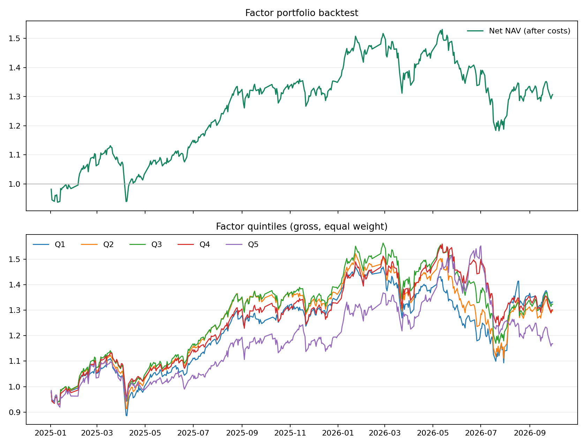
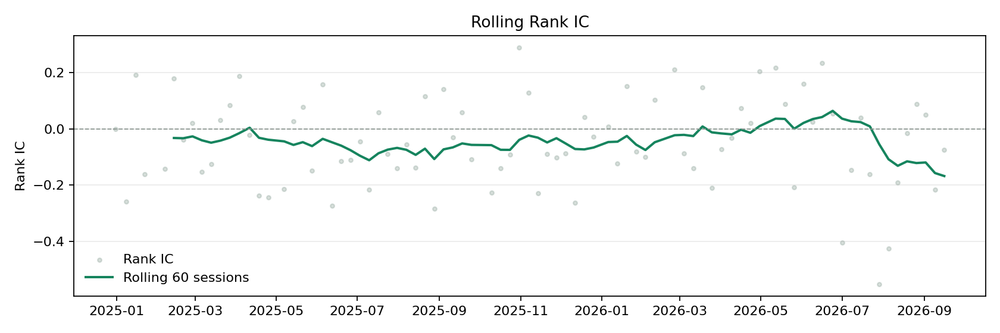

# 因子研究报告：risk_adjusted_momentum_20d

因子 `risk_adjusted_momentum_20d`，组合 `trim_tails`，每 5 个交易日调仓；高值预期更好。回测 2025-01-02 至 2026-09-30，收盘生成信号、次日开盘撮合。有效完整前瞻窗口 84 / 85。

## Factor Quality

| IC Mean | Rank IC Mean | ICIR | Rank ICIR | IC 胜率 | Rank IC 胜率 | IC t-stat | Rank IC t-stat |
|---:|---:|---:|---:|---:|---:|---:|---:|
| -0.0117 | -0.0498 | -0.081 | -0.308 | 45.2% | 39.3% | -0.75 | -2.84 |

ICIR = 每期 IC 均值 / 样本标准差；胜率按预期方向判断。t-stat 使用 Bartlett HAC 标准误，滞后阶数 0，仅描述样本内均值偏离零的程度。

## Group Returns

| 分组（低值→高值） | 累计毛收益 | 年化毛收益 |
|---|---:|---:|
| Q1 | 33.15% | 17.87% |
| Q2 | 29.66% | 16.09% |
| Q3 | 32.30% | 17.44% |
| Q4 | 30.10% | 16.31% |
| Q5 | 16.81% | 9.33% |

Top-Bottom 理论多空年化 -9.05%；逐期分组单调性均值 0.007，方向正确占比 45.2%。多空以 100% 多头和 100% 空头的日收益差复利，不计融券、费用及成交约束。

按实际选股规则拆分的理论组合：入选组年化毛收益 16.31%，未入选组 13.04%，入选减未入选的理论多空年化 2.89%。这项指标对应当前选股规则；仍未计交易费用、融券和成交约束。

## Portfolio Performance / Risk

扣费后年化 16.63%，累计 30.71%，夏普 0.85，最大回撤 -22.76%，Calmar 0.73，年化波动 23.30%，盈利交易日比例 57.4%。期末净值 ¥1,307,087,080；残余持仓市值 ¥4,434,681。

基准：`results/equal/nav.csv`；共同首日至末日的基准年化 17.67%、超额年化 0.19%、Information Ratio 0.19、Beta 1.01、算术年化 Alpha 0.05%。

ST 状态日均覆盖：官方 0.0%、价格行为推断 53.5%、未知 46.5%；期末未知比例 93.4%。未知证券仍按当前宽松股票池参与，不能视作已确认的非 ST。2026-07-06 后新出现的主板 ST 无法由原 ±5% 特征识别。逐日和逐股明细见 `status_coverage_daily.csv`、`status_coverage_by_symbol.csv`。

## Trading

年化双边成交额 / 平均净值 24.42x；佣金 ¥5,203,972，印花税 ¥13,090,167，显式费用合计 ¥18,294,140。滑点参数 0 bp 已反映在成交价，不包含在上述显式费用中。容量受限的委托尝试 369 次，占 0.03%；完整成交率 96.7%。科创板最低 200 股、北交所最低 100 股且均可逐股递增；其他证券按配置整手。

## 年度观察

| 年份 | 实际覆盖日期 | 扣费后区间收益 | 平均 Rank IC | IC 信号数 |
|---|---|---:|---:|---:|
| 2025 | 2025-01-02 至 2025-12-31 | 34.92% | -0.0587 | 48 |
| 2026 | 2026-01-05 至 2026-09-30 | -3.12% | -0.0391 | 35 |

IC 以信号日复权收盘到 5 个交易日后复权收盘收益计算，不代表可交易收益；滚动 Rank IC 使用过去 60 个交易日内的有效信号。分层曲线不计费用、容量、涨跌停和整手限制；组合净值使用撮合引擎。课程数据缺少官方历史 ST 名单，若状态来源为价格行为推断，存在漏判和误判；日线不能证明开盘真实成交。期末若有未能卖出的持仓，仍按市值计入净值。详见 `run.json`、`trades.csv.gz` 和 `trade_summary.csv`。
